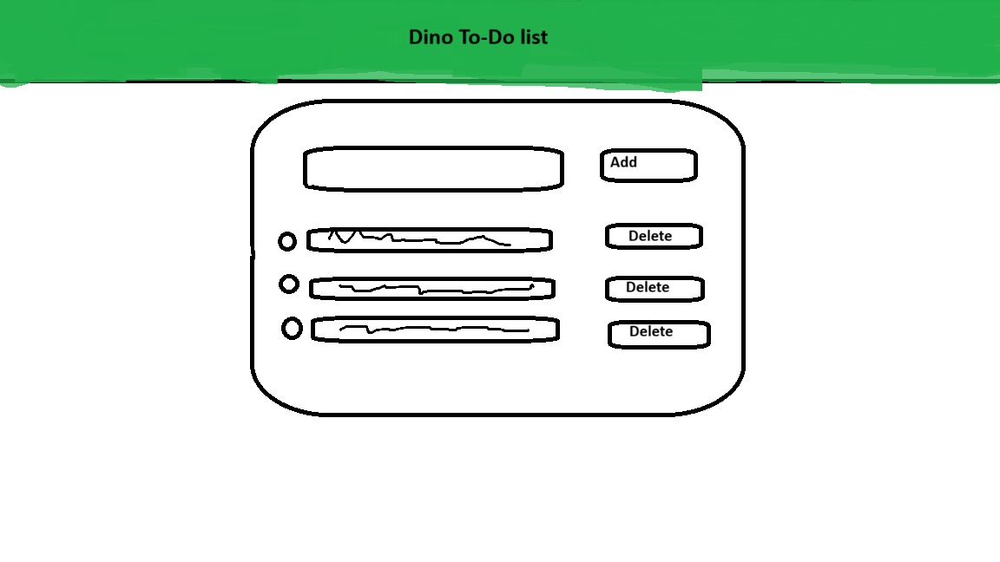
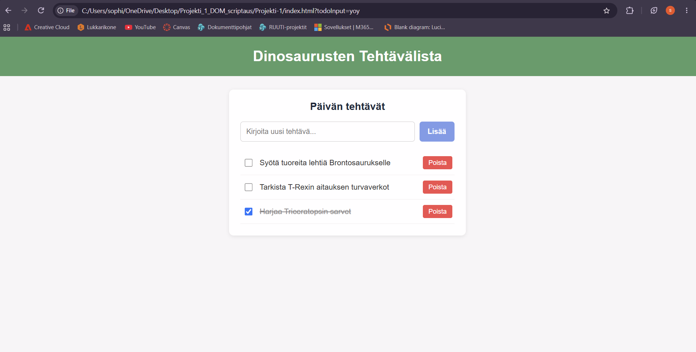

#Dinosaurusten Tehtävälista

**Tekijä**: Sophie Andonov

## Projektisuunnitelma
Otin vahvasti vaikutteita esimerkkikuvasta, joka oli tehtävänannossa, koska tykkäsin sen ulkonäöstä niin paljon. Olisin halunnut alunperin tehdä jotain muumeihin liittyvää, mutta se olisi ollut riski laillisesti :D Tykkään dinosauruksista niin se oli luonnollinen seuraava vaihtoehto.
### Projektin idea

Sovellukseni on dinosaurusten hoitajille, jos kuvitellaan, että Jurassic Park on olemassa.

### Suunnitellut toiminnot

Listaa vähintään kolme sovellukseesi suunniteltua toimintoa:

- Voi lisätä uuden tehtävän
- Voi klikata tehdyt tehtävät
- Voi poistaa tehtäviä

### Rautalankamalli / luonnos

Lisää tähän kuva käsin piirtämästäsi tai digitaalisesti tehdystä sovelluksen luonnoksesta. Luonnoksessa tulee näkyä sovelluksen pääasiallinen näkymä ja tärkeimmät elementit.

Esimerkki kuvan lisäämisestä:

## Verkkolinkit

- **Julkaistu sovellus:** [Lisää tähän GitHub Pages -osoite](http://github.com/sophieandonov/Projekti_1_DOM_scriptaus)
- **GitHub-repositorio:** [Lisää tähän repositorion osoite](https://github.com/sophieandonov/Projekti_1_DOM_scriptaus.git)

## Tietoja sovelluksesta

**[Projektin nimi]** on verkkosovellus, joka ...

Kuvaile lyhyesti sovelluksen tarkoitus ja tärkeimmät toiminnot.

## Teknologiat

Kuvaile, mitä teknologioita käytit ja mikä niiden rooli oli projektissasi.

- HTML – sivun rakenne
- CSS – ulkoasu ja asettelu
- JavaScript – toiminnallisuus, DOM-skriptaus ja lomakkeiden validointi

## Sovelluksen käyttö

Kirjoita lyhyet käyttöohjeet sovellukselle.

1. Avaa julkaistu sovellus yllä olevasta linkistä.
2. Täytä lomakkeen kentät.
3. Lisää, muokkaa, poista tai merkitse kohteita tehdyiksi.

## Sovelluksen käynnistäminen paikallisesti

1. Kloonaa tai lataa tämä repositorio omalle koneellesi.
2. Avaa projektikansio.
3. Avaa `index.html` selaimessa.

## Kuvakaappaukset

Lisää tähän vähintään yksi kuvakaappaus toimivasta sovelluksestasi.

Esimerkki kuvan lisäämisestä:

## Tunnetut virheet / puutteet

**Ei tunnettuja virheitä.**

## Oma arvio ja oppimisen reflektointi

Pohdi työtäsi ja oppimisprosessiasi.

- Missä onnistuin? Onnistuin mielestäni hyvin tehtävästä. En ole varma ymmärsinkÖ koko tehtävänantoa oikein.
- Mikä oli haastavaa? Koko tehtävä oli haastava. Koodaaminen on todella vaikea ymmärtää niin osaan vain matkia mitä ollaan aikaisemmin tehty tai mitä olen aikaisemmin oppinut. 
- Mitä parantaisin, jos aikaa olisi enemmän? Lisäisin kuvia ja tekisin sivusta ei niin kliinisen näköisen.
- Mitä opin HTML:stä, CSS:stä, JavaScriptistä ja DOM-skriptauksesta? Oli kiva käyttää js ja DOM-scriptausta. Ne on uusia asioita vielä minulle niin en sanoisi, että olen oppinut vielä. 
- Mikä jäi epäselväksi tai mistä haluaisin oppia lisää? Minun on vieläkin vaikea ymmärtää funktioita ja ehtoja. Olen myös vähän epävarma DOM skriptauksen käytöstä.
- Oma arvio projektista: **5/10 pistettä**

## Lähteet ja kiitokset

Listaa kaikki projektissa käyttämäsi lähteet, tutoriaalit, kuvat ja koodiesimerkit.

https://www.w3schools.com/css/default.asp

Jos käytit ChatGPT:tä, GitHub Copilotia tai muuta tekoälytyökalua, mainitse se tässä ja kerro lyhyesti, miten se tuki työskentelyäsi.

- [Lähteen tai tutoriaalin nimi](https://example.com/)
- [Kuvalähde](https://example.com/)
- Käytetty tekoälytyökalu: Gemini ja Visual Studio Coden omaa tekoälyä
  - Miten työkalua käytettiin: Käytin tekoälyäauttamaan ymmärtämään tehtävänantoa. Yritin tehdä aikaisemmilta tummeilta opittuja asioita, mutta en osannut tehdä sivustosta kivan näköistä niin etsin W3schoolsista kivan näköisiä css juttuja ja koska en osaanutkaan lisätä niitä oikein niin tarvitsin apua siinä. Minulla myös meni "solmuun" asioita niin VS tekoäly korjasi ongelmat ja korjasi sitten samalla myös koodia. 

  ## Lisenssi

Tämä projekti on lisensoitu MIT-lisenssillä.

Lisätietoa lisenssin lisäämisestä GitHub-projektiin:
https://docs.github.com/en/communities/setting-up-your-project-for-healthy-contributions/adding-a-license-to-a-repository